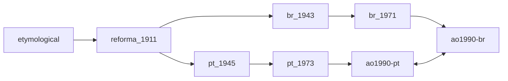

# desacordo_ortografico

<!-- agent-hint
covers: what the package does, how to install it and the first detect and convert calls
source: `desacordo_ortografico/__init__.py`, `desacordo_ortografico/convert.py:convert`, `desacordo_ortografico/detect.py:detect`
generated: no
verify: d=$(mktemp -d) && sed '/^```/d' README.md > $d/r.txt && python -I -m doctest $d/r.txt
see: `docs/index.md`, `docs/quickstart.md`, `AGENTS.md`
-->

`desacordo_ortografico` converts Portuguese text between spelling norms: the pre-1911 etymological writing, the Reforma de 1911, the Brazilian norms of 1943 and 1971, the European norms of 1945 and 1973, and the Acordo Ortográfico de 1990 (AO1990) in its European and Brazilian forms. It also detects which norm a text follows, and it flags Mirandese, Galician and Barranquenho text instead of converting it.

A conversion is a path through a graph of eight norms, applied edge by edge. Clean rules handle the regular edges (`ph` to `f`, trema, accent drops). Cited word tables handle the lexical ones (which silent consonant drops, which form a norm prefers). Some backward conversions lose information, and the result says so.

## Install

```bash
pip install desacordo_ortografico
```

The package needs Python 3.11 or later and `tugalex` 2.4.9a1 or later, which supplies the word list. The `test` extra adds `pytest`. The `benchmark` extra adds `matplotlib`, for the plots of the benchmark scripts.

## Quick start

```python
>>> from desacordo_ortografico import detect, convert
>>> detect("a pharmacia do theatro").id
'etymological'
>>> detect("o facto é óptimo").id
'pt_1973'
>>> detect("o Antônio é econômico").id
'ao1990-br'
>>> convert("pharmacia", "etymological", "ao1990-br")
'farmácia'
>>> convert("a acção directa", "pre-ao1990-pt", "ao1990-pt")
'a ação direta'
>>> convert("húmido", "ao1990-pt", "ao1990-br")
'úmido'
```

The command line does the same:

```bash
desacordo detect "a pharmacia do theatro"
desacordo convert --from pre-ao1990-pt --to ao1990-pt "a acção directa"
desacordo norms
```

## Norms

| id | norm |
|----|------|
| `etymological` | pre-1911 pseudo-etymological spelling |
| `reforma_1911` | Reforma Ortográfica de 1911 (Portugal) |
| `br_1943` | Formulário Ortográfico de 1943 (Brazil) |
| `pt_1945` | Convenção Luso-Brasileira de 1945 (Portugal and PALOP) |
| `br_1971` | accent mini-reform, Lei 5.765 (Brazil) |
| `pt_1973` | accent mini-reform, Decreto-Lei 32/73 (Portugal) |
| `ao1990-pt`, `ao1990-br` | Acordo Ortográfico de 1990, European and Brazilian |

The norms form a graph. Each arrow is one edge, and a conversion runs the edges between its two norms.



## Documentation

The documentation starts at [docs/index.md](docs/index.md).

| Page | You get |
|---|---|
| [docs/quickstart.md](docs/quickstart.md) | Detection, conversion and the full result object, with real output |
| [docs/api.md](docs/api.md) | Every public name, its signature and its default |
| [docs/features.md](docs/features.md) | The 28 conversion features and what each one changes |
| [docs/orthographies.md](docs/orthographies.md) | The eight norms and the official source of each rule |
| [docs/data.md](docs/data.md) | The JSON data files and the Hugging Face datasets |

## License

Apache-2.0.
