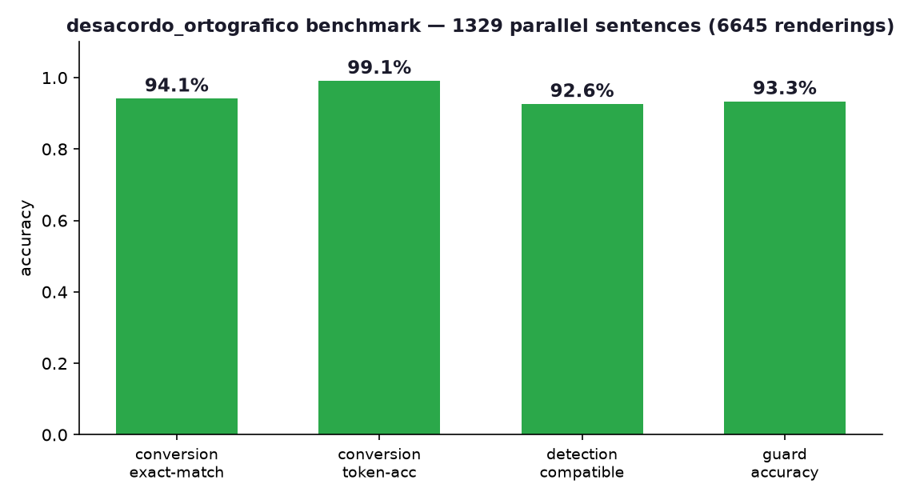
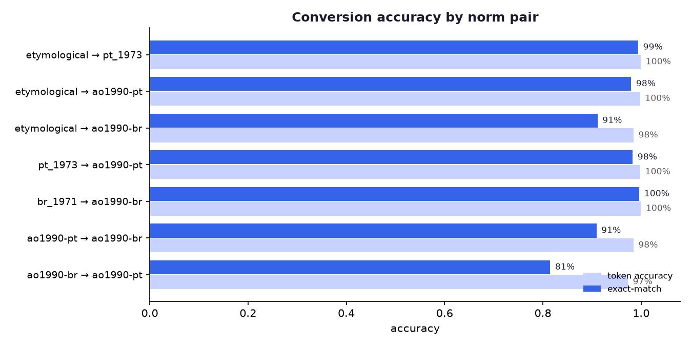
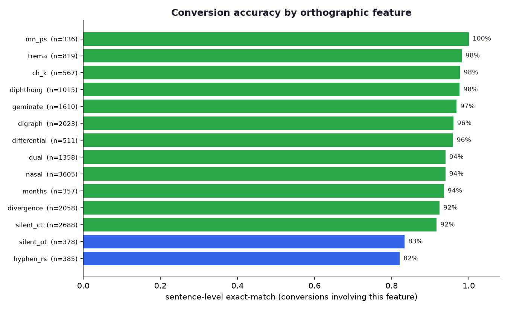
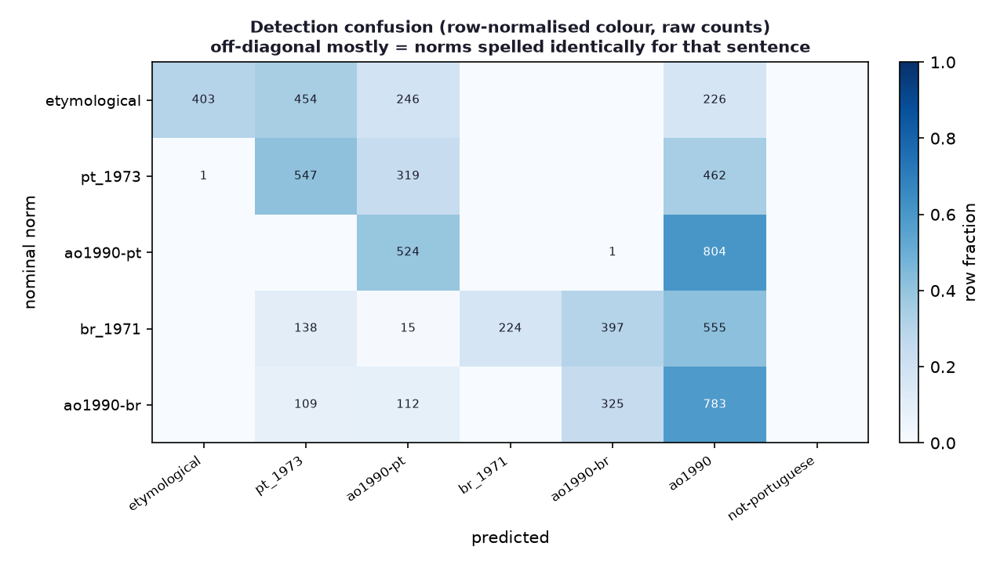

# Benchmark

A parallel silver corpus and an evaluation harness for `desacordo_ortografico`.

Language models wrote the corpus, and no person checked its rows, so it is silver data.
A score in this directory measures agreement with the silver corpus. It does not
measure accuracy against a reference that a person checked.

## What it measures

Each silver item is **one Portuguese sentence written in five orthographic norms** —
`etymological` (pre-1911), `pt_1973` (pre-AO1990 European), `ao1990-pt`, `br_1971`
(pre-AO1990 Brazilian), `ao1990-br`. From this, `run_benchmark.py` measures:

- **Conversion** — convert the silver rendering of one norm into another and check it
  reproduces the silver target (exact-match + token accuracy), per norm pair and per
  orthographic feature.
- **Detection** — classify every rendering and check the predicted norm is *compatible*
  with the column(s) it came from (renderings that are spelled identically across norms
  share an acceptable set). Plus a confusion matrix.
- **Guard** — sister-language samples (`silver_sisters.jsonl`) must be flagged as the
  right non-Portuguese variety; Portuguese controls must not be flagged.

The parallel corpus is also published as a dataset:
**[TigreGotico/desacordo_ortografico](https://huggingface.co/datasets/TigreGotico/desacordo_ortografico)**
on the Hugging Face Hub — **24,196 sentences × 5 norms** (`parallel` + `sisters` configs),
each row tagged `source: authored | derived | coverage`. Regenerate/republish with
`publish_hf.py`.

## Scaling by derivation

`silver_corpus.jsonl` holds the 1,329 sentences that the benchmark scores. `derive.py`
grows the dataset from it. The script turns a modern European sentence into all five
norms by **per-word table lookup and deterministic rules** (nasal vowel, trema, month
casing). The tables come from three sources:

- the word alignments of `silver_corpus.jsonl`.
- the AO1990 and 1911 maps of the library's own lexicon (tugalex and the files in
  `desacordo_ortografico/data/`).
- `derived_lexicon.json`, which holds the silent-consonant, trema and blocker words
  (3,593 European-line forms and 54 Brazilian forms). A language-model panel classified
  these words one by one. No person checked the classification.

`derive.py` drops a sentence that holds a word with a possible variation that no table
covers. This keeps a derived row consistent with the tables. It does not make the row
correct: an error in a table goes into every derived row that uses the word.
`derive_corpus.py` runs the derivation over the modern sentences in `gen/out/` and infers
the feature labels of each row. The benchmark scores only `silver_corpus.jsonl`, because
the derivation uses the library's own maps and a score on derived rows would be circular.
The derived rows are in the Hugging Face dataset only.


## Word-level coverage

`derive.py` only reaches words it can verify, so the generated sentences alone exercise a
fraction of each AO1990 change. `cover.py` closes the gap: for every changed word in the
lexicon still missing from the corpus it emits a short carrier sentence (one quoted term,
`source: coverage`). Result: **every** changed word — silent c/p, trema, open-diphthong
accent, dual and divergence — appears at least once — 100% of the inventory, no exclusions.

## The corpus

`build_corpus.py` merges two sources into `silver_corpus.jsonl`:

- `silver_parallel.jsonl`, 21 multi-feature sentences.
- `parts/part_*.jsonl`, about 1,300 sentences over 12 topic domains.

Language models wrote all of these rows against a per-norm rule card. The commit that
added `silver_parallel.jsonl` calls its 21 sentences hand-authored, but that commit is a
language-model commit. No record shows that a person wrote or checked a row. A
language-model QA pass then changed 88 sentences and dropped 3 (`qa/out/`, applied by
`merge_qa.py`). `silver_sisters.jsonl` (the guard samples) went through the same QA pass.

The library did not write the sentences, but the corpus is not independent of the
library. `clean_silver.py` writes forms from the library's own maps into some cells.
Because the European line (etymological / pt_1973 / ao1990-pt) and the Brazilian line
(br_1971 / ao1990-br) can differ in *lexis* (ficheiro/arquivo), the cleaner checks
consistency **within each line**, where cells differ only by era transforms. It does
three things:

1. It replaces a dual or divergence word in an AO1990 cell with the variant from the
   library's maps.
2. It replaces an etymological token with the pt_1973 token when neither the 1911 word
   map nor the digraph and geminate rules reduce it to that token.
3. It drops a sentence whose European or Brazilian line is internally inconsistent
   (article slips, different words, token-count mismatches).

The consistency check compares the cells of one line with each other. It does not find a
wrong form that is the same in every cell of the line, for example a European spelling
in both Brazilian cells.

Note on PT↔BR conversion: the European and Brazilian lines can diverge *lexically*
(quinta/fazenda), which an orthographic converter correctly does not translate — so the
cross-variant pairs are capped below 100% by design, not by a bug.

## Reproduce

```bash
pip install -e . matplotlib            # plus tugalex
python benchmark/build_corpus.py       # merge + validate parts -> silver_corpus.jsonl
python benchmark/clean_silver.py       # line consistency (drops inconsistent sentences)
python benchmark/run_benchmark.py      # -> results.md + results.json
python benchmark/plot_results.py       # -> plots/*.png
python benchmark/train_detector.py     # CV the learned detectors + ship models
python benchmark/diagnose.py           # attribute failures (rule vs silver, where)
```

## Headline results



- **Conversion:** ~88% sentence-level exact-match, ~98% token accuracy over ~9.2k
  directed conversions. The same-line conversions are strongest
  (`br_1971→ao1990-br` ~99%, `pt_1973→ao1990-pt` ~96%); the cross-variant PT↔BR pairs
  (~89%) are capped by lexical divergence, and the pre-1911 directions by accent
  restoration (see limitations).
- **Detection:** ~94% compatible accuracy (rules) across 6.6k renderings; the learned
  models reach ~96% (below).
- **Guard:** flags Mirandese / Galician / Barranquenho correctly and leaves Portuguese
  alone, modulo one Astur-Leonese sentence whose only cue is a medial diphthong the
  marker set doesn't cover.





## Learned detectors (NB + perceptron)

`train_detector.py` trains two zero-dependency models over character n-grams and
evaluates them against the rule scorer with **5-fold CV split by sentence** (so no
near-identical rendering leaks across train/test). Both beat the rules on held-out data:

| detector | strict | compatible |
|----------|--------|------------|
| rules | 33.3% | 94.4% |
| naive bayes | 49.2% | **96.2%** |
| averaged perceptron | 48.6% | 95.1% |

(Strict accuracy is capped well below 100% because many renderings are spelled
identically across norms and cannot be told apart; *compatible* is the meaningful
metric.) Both models ship (`data/detector_nb.json`, `data/detector_perceptron.json`)
and are opt-in via `detect(text, method="nb"|"perceptron")`; the rule scorer stays the
default for explainability and robustness on short inputs.

## Known limitations the benchmark exposes

- **Graphic-accent restoration (etymological edge).** The 1911 reform *introduced*
  systematic accents, so the deterministic `ph→f`/`y→i` rules cannot supply them. The
  library guesses the accent from the word list (`fosforo→fósforo`). A bare form that is
  itself a word, or a regular inflection of one, stays as written unless the word before
  it or the caller's part-of-speech tags settle it (see `docs/api.md`). A pre-1911 word
  absent from the list keeps a bare vowel. This benchmark cannot score the guess:
  `clean_silver.py` writes the pt_1973 accents into the etymological cells, so the silver
  corpus holds almost no bare pre-1911 word that needs an accent.
- **Inflected silent consonants.** Dropping the silent c/p of `-ct-/-pt-` is lexical;
  the rule fallback only fires when the modernised form is an attested word, so
  inflections missing from the word list (`desactiva→desativa`) are left unchanged. A
  richer word list (e.g. enriching tugalex) closes this directly.
- **Reverse (newer→older) conversions** are lexical and lossy by nature, and are
  reported via `ConversionResult.lossless`/`warnings`.
