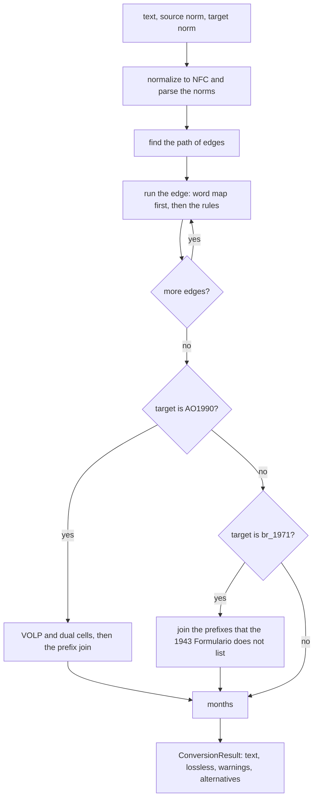
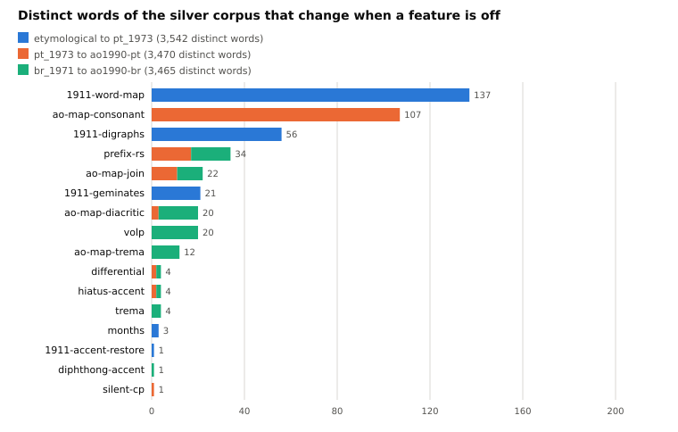

# Conversion features

<!-- agent-hint
covers: the 28 named conversion features, the edge of each, the words each changes, and the rules of the word maps
source: `desacordo_ortografico/convert.py:FEATURES`, `desacordo_ortografico/convert.py:OrthographyConverter`, `desacordo_ortografico/rules.py`, `tools/build_docs_plots.py`
generated: `assets/feature_words_light.svg` and `assets/feature_words_dark.svg` by `python tools/build_docs_plots.py --write`
verify: python tools/build_docs_plots.py --check && d=$(mktemp -d) && sed '/^```/d' docs/features.md > $d/f.txt && python -I -m doctest $d/f.txt
see: `api.md`, `orthographies.md`, `index.md`
-->

A conversion runs a list of named features. Each feature is one small step: a rule, a word table or a casing fix. This page lists the 28 features, shows which ones do the work on real text, and gives the full rule of the long ones.

## How a conversion runs

`convert()` finds the path between two norms in the norm graph and runs each edge of the path in turn. A word map decides first, and the rules of the edge act on the words the map does not hold. A few steps run once on the whole path.



Only the backward pass of an edge is lossy, and every edge except `ptbr_divergence` has a lossy backward pass. A forward conversion always gives `lossless` as `True`. A backward conversion sets `lossless` to `False` and adds one warning for each lossy edge. `convert("a acção do director", "pt_1973", "ao1990-pt")` drops two consonants and stays lossless. The reverse conversion is lossy.

## Try a feature

`features` takes the names of the features that may run. `None` runs all of them. Pass one name to see what that feature does alone, or an empty collection to run none.

```python
>>> from desacordo_ortografico import convert
>>> convert("a acção do director", "pt_1973", "ao1990-pt")
'a ação do diretor'
>>> convert("a acção do director", "pt_1973", "ao1990-pt", features={"ao-map-consonant"})
'a ação do diretor'
>>> convert("a acção do director", "pt_1973", "ao1990-pt", features={"trema"})
'a acção do director'
>>> convert("a acção do director", "pt_1973", "ao1990-pt", features=set())
'a acção do director'
>>> convert("o auto-retrato", "pt_1973", "ao1990-pt", features={"prefix-rs"})
'o auto-retrato'
>>> convert("o auto-retrato", "pt_1973", "ao1990-pt", features={"ao-map-join"})
'o autorretrato'
```

The map feature `ao-map-consonant` converts both words, because the AO1990 word map holds them. The `trema` feature has nothing to change in this sentence, so the text stays as written. A name that is not a feature raises `ValueError`, and the message lists the valid names.

## Which features change words

The chart counts, for each feature, the distinct words of the silver corpus that convert differently when the feature is off. Each word of the source rendering of a route is converted alone, once with every feature and once without the feature. The three routes are etymological to pt_1973, pt_1973 to ao1990-pt and br_1971 to ao1990-br. [The benchmark README](../benchmark/README.md) describes the corpus. `tools/build_docs_plots.py --count` recomputes the counts, and `--write` redraws the chart.

<picture>
  <source media="(prefers-color-scheme: dark)" srcset="assets/feature_words_dark.svg"> 
</picture>

The word maps do most of the work, and the rules reach the words that no map holds. Twelve features are absent from the chart because turning each one off changes no word. The reasons differ:

- `initial-sc` and `post-1911-word-map` both convert the word sciência. Each one makes the other redundant, so the count is 0 when one of them is off. Each one changes the word when it runs alone.
- `differential-1971`, `nasal-vowel` and `ptbr-divergence` run on edges that none of the three routes crosses.
- `base-iv` runs on the route to ao1990-pt, but the AO1990 word map already owns every listed word of the corpus, and the map decides first.
- `differential-1945`, `grave-u` and `oxytone-em` run on the first route. Its candidates in the etymological words are pêlo, pêra and pôr, which Base XXII keeps, and crêem and lêem, whose hiatus êem stays. The words have no -êm or -êns oxytone and no qù or gù.
- `subtonic-grave` runs on the first route, and the etymological words have no grave accent on e, i, o or u, the only letters it changes.
- `ao-map-locution` and `hyphen-lexical` find no row of their lists in the corpus words, and each word converts alone.

The tests under `tests/` exercise each of them.

## The features by edge

Each edge of the norm graph is an ordered list of feature steps. The tables group the features by edge.

### Pre-1911 to 1911

These features run on the `reform_1911` edge.

| Feature | What it changes | Edges |
| --- | --- | --- |
| `1911-word-map` | the pre-1911 -> 1911 rows of the spelling table (pharmacia -> farmácia, comsigo -> consigo), see below | reform_1911 |
| `1911-digraphs` | ph, th, rh -> f, t, r; y -> i | reform_1911 |
| `1911-geminates` | doubled consonants, except rr and ss | reform_1911 |
| `1911-accent-restore` | the graphic accent of a unique accented form (fosforo -> fósforo), see below | reform_1911 |

### 1911 to 1945 and 1943

These features run on the `pt_1911_to_1945` and `br_1911_to_1943` edges. Four of them are rules.

| Feature | What it changes | Edges |
| --- | --- | --- |
| `trema` | ü -> u after g, q or a vowel (freqüência -> frequência, saüdade -> saudade). A derivative of a foreign name keeps it (mülleriano, AO1990 Base XIV 1º Obs.) | pt_1911_to_1945, ao1990_pt, ao1990_br |
| `oxytone-em` | -êm, -êns -> -ém, -éns in an oxytone of more than one syllable (tambêm -> também); a compound of ter or vir in -têm, -vêm stays | pt_1911_to_1945, br_1911_to_1943 |
| `grave-u` | qù, gù -> qu, gu toward 1945 and qü, gü toward 1943 (tranqùilo) | pt_1911_to_1945, br_1911_to_1943 |
| `initial-sc` | initial sc -> c in the words of 1911 Base XI and their derivatives (sciência -> ciência, scintilava -> cintilava); an English word with the same letters (scientific, sceptical) loses its s too | pt_1911_to_1945, br_1911_to_1943 |

Two more features read a word table and the 1945 circumflex list.

| Feature | What it changes | Edges |
| --- | --- | --- |
| `post-1911-word-map` | the 1911 to pt_1945 and 1911 to br_1943 rows of the spelling table (quási -> quase, tam -> tão) | pt_1911_to_1945, br_1911_to_1943 |
| `differential-1945` | the 1911 circumflex that the 1945 Acordo no longer writes (êle -> ele, côr -> cor) | pt_1911_to_1945 |

### The 1971 and 1973 accents

These features run on the `accent_1971` and `accent_1973` edges.

| Feature | What it changes | Edges |
| --- | --- | --- |
| `subtonic-grave` | sòmente -> somente | accent_1973, accent_1971 |
| `differential-1971` | the 1971 differential circumflex list, from 1943 Formulário 14.ª (êle -> ele, sôbre -> sobre), in each part of a hyphenated word too (fêz-se -> fez-se) | accent_1971 |

### The PT/BR divergence

These features run on the `br_1911_to_1943`, `ao1990_pt` and `ptbr_divergence` edges.

| Feature | What it changes | Edges |
| --- | --- | --- |
| `base-iv` | the curated Base IV drop list | br_1911_to_1943, ao1990_pt |
| `ptbr-divergence` | the PT/BR divergence pairs (connosco -> conosco) | br_1911_to_1943, ptbr_divergence |
| `nasal-vowel` | é/ó -> ê/ô before a nasal | br_1911_to_1943, ptbr_divergence |

### The AO1990 word map

These features run on the `ao1990_pt` and `ao1990_br` edges.

| Feature | What it changes | Edges |
| --- | --- | --- |
| `ao-map-consonant` | AO1990 map rows that change letters (acção -> ação) | ao1990_pt, ao1990_br |
| `ao-map-diacritic` | AO1990 map rows that change only accents (pêlo -> pelo) | ao1990_pt, ao1990_br |
| `ao-map-trema` | AO1990 map rows that drop only the trema | ao1990_pt, ao1990_br |

Two more rows of the map change hyphens.

| Feature | What it changes | Edges |
| --- | --- | --- |
| `ao-map-join` | AO1990 map rows that fuse hyphenated parts (auto-retrato -> autorretrato) | ao1990_pt, ao1990_br |
| `ao-map-locution` | AO1990 map rows whose hyphens become spaces (fim-de-semana -> fim de semana) | ao1990_pt, ao1990_br |

### AO1990 rules

These features run on the `ao1990_pt` and `ao1990_br` edges.

| Feature | What it changes | Edges |
| --- | --- | --- |
| `differential` | the AO1990 differential accent list (pára -> para) | ao1990_pt, ao1990_br |
| `hyphen-lexical` | the AO1990 joined-compound list (manda-chuva -> mandachuva) | ao1990_pt, ao1990_br |
| `diphthong-accent` | éi/ói in a paroxytone (jibóias -> jiboias). Oxytones (herói, rói-rói) and proparoxytones (alantóideo) keep it | ao1990_pt, ao1990_br |
| `hiatus-accent` | ôo and êem (vôo -> voo) | ao1990_pt, ao1990_br |

### Features that read the whole path

These are steps that run once per conversion, not once per edge.

| Feature | What it changes | Edges |
| --- | --- | --- |
| `silent-cp` | the regular plural of an AO1990 map word that drops a c/p (actos -> atos), and back | ao1990_pt, and every conversion to ao1990-pt |
| `prefix-rs` | a listed prefix joins its second element (auto-regulável -> autorregulável) | every conversion to ao1990-pt, ao1990-br or br_1971 |
| `volp` | the ABL VOLP form of each pt-BR word that `data/volp_ao1990_br.json` holds (fato -> facto) | every conversion to ao1990-br |
| `months` | month casing: a capital toward an older norm, lowercase toward AO1990 | every conversion |

## Long feature rules

The tables give the gist of each feature. This section gives the full rule of the features that need more room.

### `post-1911-word-map`

The step reads the 1911 to pt_1945 and 1911 to br_1943 rows of the spelling table (quási -> quase, tam -> tão, teem -> têm, scetro -> ceptro). The noun row reads its plural (scetros -> ceptros). The adverb and verb rows do not (tams stays). A word whose parts repeat (tam-tam, tam-tams) stays. Backward, the curated rows apply inverted (cena -> scena, ciência -> sciência) and no plural is read (cenas stays).

### `differential-1945`

The step drops the 1911 circumflex that the 1945 Acordo no longer writes (êle -> ele, côr -> cor, vôo -> voo), when the bare letters spell a listed Portuguese word. The forms that Base XXII keeps stay (pêlo, pôde). The French prêtres, être and the pre-1911 fêl-o stay. A French word whose bare letters are listed (Côte, tête, pôle) loses the accent.

### `silent-cp`

The step converts the regular plural of an AO1990 map word that drops a c/p (actos -> atos), and back (atos -> actos). Toward ao1990-pt it also converts two more kinds of word:

- each element of a compound that the map does not hold, before the prefix join (directores-gerais -> diretores-gerais)
- the joined word, after the prefix join (electro-acústica -> eletroacústica). The dual multissectorial keeps its c.

The step runs on every conversion to ao1990-pt.

### `prefix-rs`

The step joins a listed prefix to its second element (AO1990 Base XVI). It runs on every conversion to ao1990-pt, ao1990-br or br_1971. The join follows these rules:

- r or s doubles (auto-regulável -> autorregulável).
- A different vowel joins (auto-estradas -> autoestradas).
- co- joins before a vowel or a consonant (co-autores -> coautores).
- The same vowel and h keep the hyphen. The exception is pt-BR, which writes co- before h solid, without the h (co-herdeiro -> coerdeiro).
- A loanword (co-working) keeps the hyphen. So does a hyphenated loanword that the vocabulary of the target variety lists (VOLP mini-system, VOP anti-apartheid, in `data/hyphen_loanwords.json`), with its English plural (mini-systems). So does a second element that does not start with a letter (co-1).
- euro- is no prefix of the join. It is europeu reduced, and AO1990 Base XV 1 writes a compound of two adjectives with the hyphen (euro-africano stays).

The join runs once on the words of an AO1990 target, after the VOLP and the dual cells decide each element (pt_1973 foto-receptores -> ao1990-br fotorreceptores). A pre-1990 target keeps the hyphen, so pt_1973 <-> br_1971 keeps co-autores.

At br_1971, a prefix that the 1943 Formulário does not list (46 5.º) joins before r or s and doubles it (micro-sistema -> microssistema, 22). euro-, co-, a name inside a sentence (40) and a VOLP loanword row (mini-system) keep the hyphen.

### `volp`

The step gives each pt-BR word that `data/volp_ao1990_br.json` holds the form of the ABL VOLP (fato -> facto, aceção -> acepção). It runs on every conversion to ao1990-br.

- A name inside a sentence keeps a form the VOLP lists (e Coletivo Farra).
- Before a prefix joins, the VOLP decides each element (co-director -> codiretor).
- After the join, the VOLP decides the joined word (co-fatores -> cofactores -> cofatores).
- The VOLP writes contra-erva with the hyphen, so contra-erva -> contraerva -> contra-erva.

### `months`

The step sets the case of months and seasons on every conversion.

- Toward an older norm a month takes a capital, and so does a season that opens a sentence.
- Toward AO1990 a month takes lowercase.
- At the start of a sentence a month keeps the case it was written in.
- An opening quote or bracket does not stop a sentence opening («Janeiro chegou», disse ele).

## How the word maps behave

The AO1990 word map owns the words it holds. When the class of a word's row is off, the word stays as written, and the rules of that edge do not change it either. The 1911 word map owns its words in the same way.

Backward, each AO1990 map row also maps the regular plural of its new form to the plural of its old form: br_1971 gets `co-diretores` from `codiretores` and `idéias` from `ideias`. A bare form whose differential accent comes back keeps its plural bare (`pera` gives `pêra`, and `peras` stays: Acordo de 1945, Base XXII).

A row whose old and new forms both end in -ar also converts the regular forms of that verb, forward and back, with the feature of the row: the endings are those of the first conjugation model, cantar (Cunha & Cintra, cap. 13). So `adoptar -> adotar` gives `adoptou -> adotou`, `projectaram -> projetaram` and `detecta -> deteta`, and the base-iv and silent-cp steps read the same forms. A stem in c, g or ç changes before e on both sides (`electrifiquei -> eletrifiquei`). A word of the modern word list stays as written (`retracto`, the noun, against `retractar -> retratar`), and so does an element of a compound that is listed. The verbs `coletar` and `retratar` give no forms, because `colete` and `retrato` are nouns. The forms of -er and -ir verbs (`reflectir -> refletir`) are not derived.

The bare form of contrato, retrato, trato, corretor, edital and retor is a word of its own, so it gains no consonant backward (`os corretores` stays).

## The 1911 word map

The 1911 word map is the pre-1911 -> 1911 rows of the spelling table `data/spelling.json`: the curated 1911 pairs and rows of the tugalex archaisms list. A tugalex row gives the modern pt-PT form, so `tools/build_spelling_table.py` made it a 1911 row only when its 1911 form is known. Where the AO1990 pt-PT map lists the modern form, the 1911 form is the pre-AO1990 form of that map (architecto -> arquitecto). A row stays out when its modern form drops a c or p that no table restores (affectando, AO1990 afetando), drops the initial sc that 1911 keeps (scintillar), is the bare form of a differential accent (pello, AO1990 pelo), or drops an ê or ô of the archaic form (sêcco, 1911 sêco by Base XXVIII). Such a row holds only its AO1990 forms, and the word converts by the rules, as words outside the map do. For the other rows the modern form stands for the 1911 form, and an accent that the archaic form does not show can still be missing (elle gives ele, where 1911 writes êle).

Both varieties share the 1911 form, so a row also stays out when the Brazilian edges do not turn the form it gives the 1911 map into its pt-BR form (character, pt-BR caráter). This check tests only the rows whose form for the 1911 map differs from their pt-BR form. For the other rows it only shows that the Brazilian edges keep the word, and it says nothing about the 1911 form. Where the curated pairs and the tugalex list hold the same word, the table holds the curated pair. The backward pass reads the curated pairs only, because several archaic forms can share one modern form.

## Foreign words in the 1911 edge

The 1911 Formulário reforms "todas as palavras portuguesas, ou aportuguesadas", so the digraph and geminate rules of the 1911 edge leave a loanword or a foreign name as written. The 1911 word map still applies first:

```python
>>> from desacordo_ortografico import convert
>>> convert("a pharmacia de Hollywood", "etymological", "pt_1973")
'a farmácia de Hollywood'
>>> convert("o whisky e o kiosque", "etymological", "pt_1973")
'o whisky e o quiosque'
```

These letters mark a foreign spelling:

- k or w, zz, sh, or an initial y before a vowel
- a final pair of consonants whose last letter is not l, m, n, r, s, x, y or z, other than ch, ph, th and cc (Clifford, Scott)
- a ü that follows neither g, q nor a vowel (mülleriano)

A y inside a word is no such mark, because pre-1911 Portuguese writes it (Moreyra gives Moreira). The test reads letters only, so it has known limits. taylorista gives tailorista, Smith gives Smit, and Russell gives Russel. Joseph gives Josef, not the José of AO1990 Base I 4º. Yara and razzia stay as written.

## The 1911 accent guess

The 1911 accent guess gives a bare word the accent of the one accented word that has the same letters. A bare form that is itself a word stays as written (para, pára). So does a regular inflection of a word, unless the context settles it:

| Bare form | Example | Takes the accent |
| --- | --- | --- |
| not a word and no inflection | fosforo -> fósforo | always |
| only a verb form | historia (historiar), continua (continuar) | after a determiner or a preposition (a sua história, de música); else when tagged NOUN or ADJ |
| only a plural in -s | pais (pai) | after a singular determiner: o país, os pais |
| a nominal form | antigas (antigo), tanta (tanto) | never |

A bare article (o, a, os, as) is also a clitic pronoun, so it counts as a determiner by the variety of the target norm. For a European target it counts unless a word such as não, que, já or quando stands right before it. For a Brazilian target it counts only at the start of a sentence or clause or after a preposition. Elsewhere the bare article is the clitic pronoun, and the next word is a verb. A pause ends the context: the word before a comma, a colon, a parenthesis or a dash decides nothing about the word after it. Brackets are no pause: they hold remarks an author adds inside a transcribed text. A tag decides only a word that this rule leaves undecided: it never removes an accent the rule gives, and never adds one after a clitic pronoun.

A capitalised word takes the accent of the common word with the same letters, anywhere in a sentence. So names whose 1973 spelling carries an accent come back right (Árctico, Atlântico, Ministério Público). The city names Coimbra and Roma and the given name Ester share their letters with an accented common word (coimbrã, romã, éster). They stay as written when capitalised: "Fui a Roma." stays "Fui a Roma.", and "uma roma madura" gives "uma romã madura". Pre-1911 Esther gives Ester, the name that the 1943 Vocabulário lists beside the chemical éster.

The 1911 word map writes treno for threno, the lament, so treno is a word and the guess leaves it as written: "o threno" gives "o treno", and a bare treno stays treno. Figueiredo 1913 lists "Treno" (the lament) and "Trenó" (the sled) as two headwords.

---
[← API reference](api.md) · [Home](index.md) · [Orthographies →](orthographies.md)
